Vulkan Grass Rendering
==================================

**University of Pennsylvania, CIS 565: GPU Programming and Architecture, Project 5**

* Kevin Du
  * [LinkedIn](https://www.linkedin.com/in/kevinwdu/), [personal website](https://kevindu.dev)
* Tested on: Windows 11, Intel Core Ultra 5 225F @ 3.30 GHz, 32 GB RAM, RTX 5060 (8 GB)

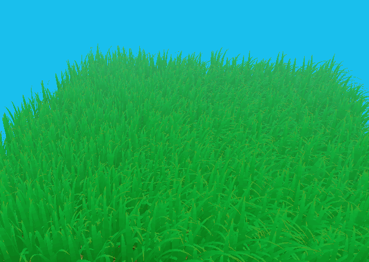

CMakeLists changes: Updated the CMakeLists version

## Summary

This project simulates and renders a field of grass in Vulkan using techniques described in this paper, [Responsive Real-Time Grass Rendering for General 3D Scenes](https://www.cg.tuwien.ac.at/research/publications/2017/JAHRMANN-2017-RRTG/JAHRMANN-2017-RRTG-draft.pdf). Each blade is represented by a quadratic Bezier curve, updated by a compute shader, and expanded into a tapered surface by the tessellation pipeline. Gravity, recovery, and wind forces are simulated, while three culling tests reduce the amount of grass sent to the graphics pipeline.

### Features Implemented

#### Grass Rendering

- **Procedural blades:** Randomized positions, orientations, heights, widths, and stiffness values give the field variation. Each blade stores its root, curve guide, physical tip, and up direction in four `vec4` values.
- **Bezier geometry:** The vertex shader transforms the control points into world space. Tessellation evaluates a quadratic Bezier centerline and offsets the surface across the blade's width, tapering it to a point at the tip.
- **Tessellation:** Each blade enters the graphics pipeline as a single patch. Fixed tessellation levels provide more subdivisions along its length, resolving the bend without storing a full mesh for every blade.

The first WIP images where I set up the geometry and then add color:

| Unshaded geometry | Height-based coloring |
| --- | --- |
| 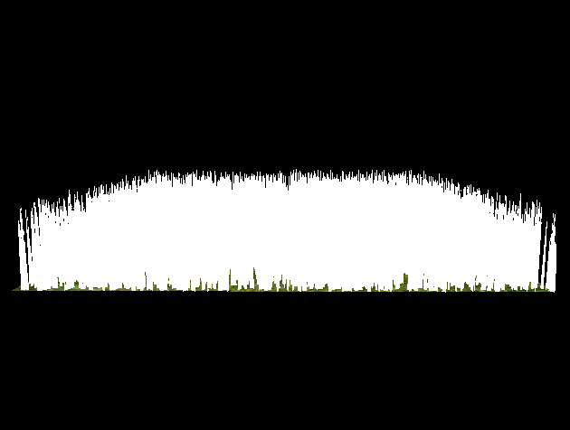 | 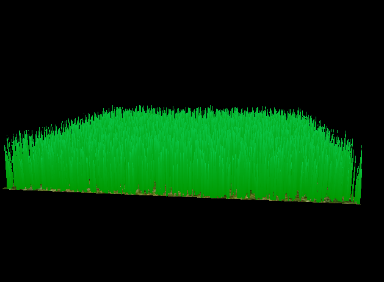 |

#### Simulating Forces

The compute shader updates every blade each frame using the elapsed simulation time:

- **Gravity:** Environmental gravity acts downward, with an additional component along the blade's front direction to encourage bending.
- **Recovery:** A spring-like force pulls the physical tip toward its upright rest position. Per-blade stiffness controls how strongly it resists bending.
- **Wind:** A cosine function varies the wind with time and the blade's position. Projecting the wind onto the blade's front direction makes the wind intensity depend on its orientation.
- **Shape constraints:** After applying the forces, the update removes sideways displacement across the blade's width, prevents the tip from moving below the root, and constrains the root-to-tip distance to the stored height.

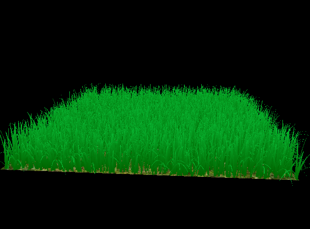

| Initial version | After adding some culling |
| --- | --- |
| 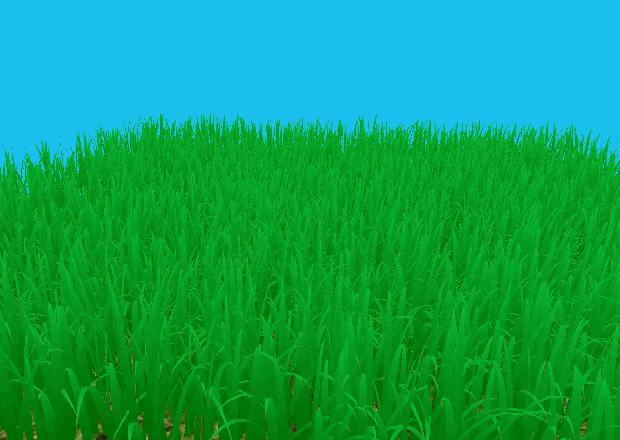 | 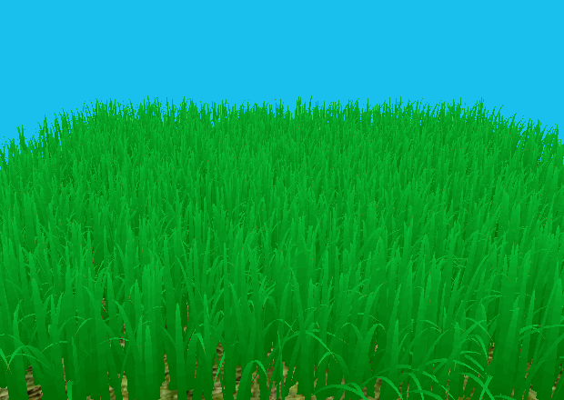 |

#### Culling

Culling runs in the compute shader after the force updates. Surviving blades are compacted into an output buffer using an atomic counter, and `vkCmdDrawIndirect` uses that count to draw them. Blades continue to receive simulation updates even when they are culled.

- **Orientation culling:** Rejects blades viewed almost edge-on using the camera's forward direction and the blade's front direction. A check against the up direction limits culling to relatively horizontal views.
- **View-frustum culling:** Tests the root, tip, and Bezier midpoint in clip space. A blade is rejected when all three sample points are outside the view frustum. A small margin in the horizontal and vertical tests reduces popping near the screen edges.
- **Distance culling:** Keeps all blades closer than 25 units, approximately 60% from 25 to 37.5 units, and approximately 30% from 37.5 to 50 units. Blades at 50 units or farther are removed. The blades are hashed by index to select the retained blades, keeping the selection stable within each distance band.

| Frustum-culling demonstration (exaggerated margins to showcase culling) | Distance-culling demonstration |
| --- | --- |
| 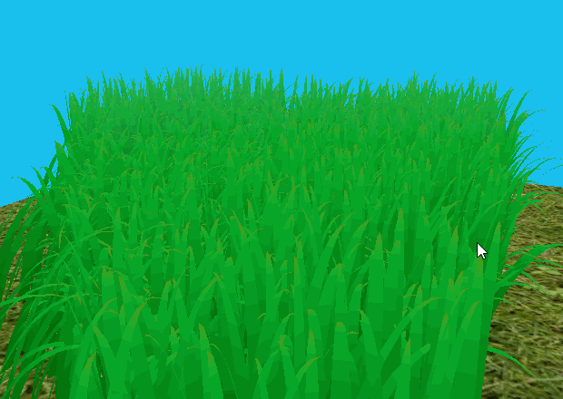 | 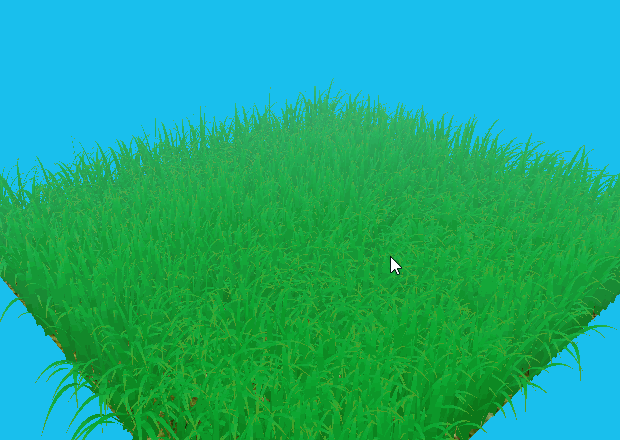 |

## Performance Analysis

### Measurement Method

Measurements were collected in **Release mode at the starting camera position**. Each reported value is an average of several five-second measurement intervals.

A C++ timer is used around each iteration of the main frame loop. It starts before event polling and ends after the scene time update and `Renderer::Frame()`, covering image acquisition, command submission, and the presentation call. Initialization and the timing report itself are outside the measured frame work.

The blade-count benchmark varies `NUM_BLADES` with all culling enabled. The application opens at 640 x 480.

### Blade Count Performance

The first graph shows the measurements through 262,144 blades. Its horizontal axis is logarithmic, while its vertical axis is linear:

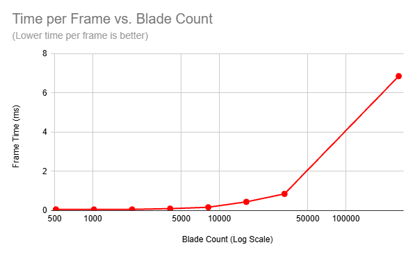

The full-range graph includes all ten measurements, extending to 4,194,304 blades. Both axes are logarithmic so that the smallest and largest workloads remain readable. Point labels give the measured frame times in milliseconds; connecting lines show the trend between measured samples.

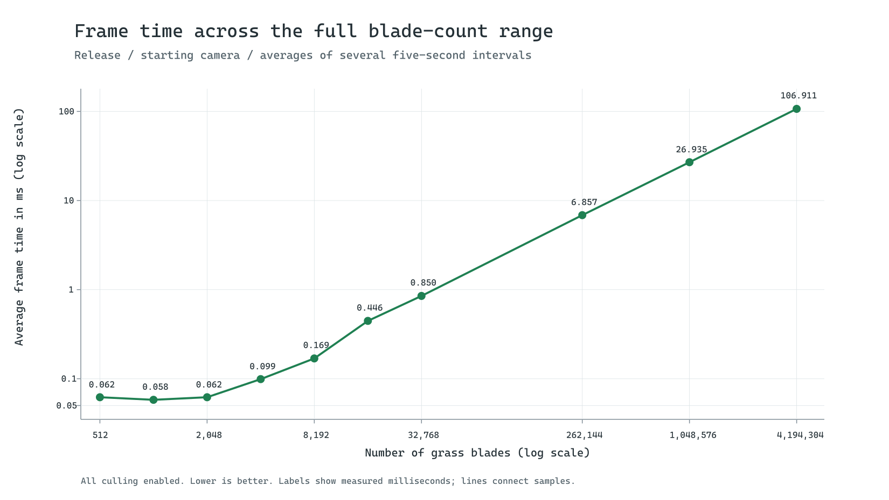

At **512 to 2,048 blades**, frame time stays near **0.06 ms**. The small drop from 0.062 ms at 512 blades to 0.058 ms at 1,024 blades is either due ro measurement variation and/or overhead dominating a small workload.

At larger workloads, the cost grows approximately in proportion to the number of blades. Increasing the count from **262,144 to 4,194,304** multiplies the workload by **16**, while frame time rises from **6.857 ms to 106.911 ms**, a factor of about **15.6**.

This trend is consistent with the implementation: every blade receives a compute update, while each visible blade uses the same tessellation settings. With a fixed camera and field size, adding blades increases simulation work and typically increases the number of visible patches, vertices, and fragments.

### Performance Improvements via Culling

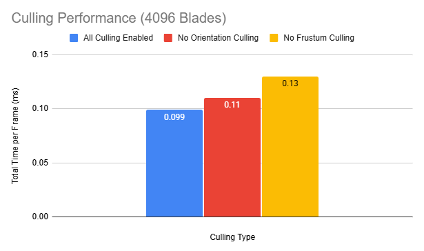

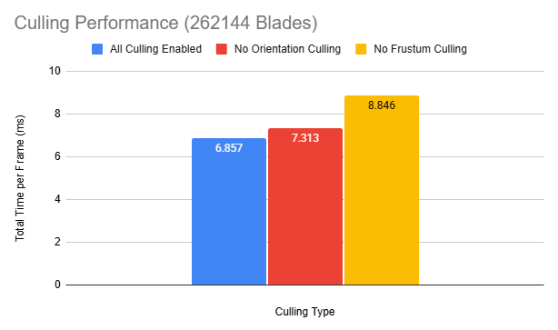

With a 0.9 orientation threshold, **Orientation culling** reduces frame time from **0.110 to 0.099 ms** at 4,096 blades and from **7.313 to 6.857 ms** at 262,144 blades. These are reductions of **10.0%** and **6.2%**, respectively, relative to each configuration with orientation culling disabled. Edge-on blades contribute little visible area but still incur geometry-processing work, so removing them can save time.

**Frustum culling** has the larger measured effect. Enabling it reduces frame time from **0.130 to 0.099 ms** at 4,096 blades and from **8.846 to 6.857 ms** at 262,144 blades: reductions of **23.8%** and **22.5%**. At the higher count, that saves **1.989 ms per frame**. This large improvement is likely due to much of the grass plane being outside of the starting position camera's frustum. Rejecting off-screen blades before the graphics pipeline avoids their tessellation and vertex-processing work.
